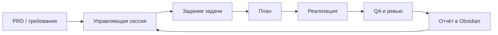

# Engineering Agent Kit

**От PRD до проверенной реализации — с понятными заданиями, отдельными рабочими папками и сохранённым контекстом.**

Kit помогает организовать разработку с Codex: разобрать требования, разделить фичу на задачи, реализовать их в отдельных сессиях, провести QA и ревью. Управляющая сессия собирает результаты через общие артефакты в Obsidian. Пользователь управляет приоритетами и принимает решения.

Это локальный инструмент для Linux/WSL. Роли по умолчанию выполняются последовательно; отдельные сессии открывает пользователь. Kit не создаёт обязательную команду параллельных агентов.

[Быстрый старт](#быстрый-старт) · [Первая фича](#первая-фича-по-prd) · [Skills](#skills) · [Настройки](#локальные-настройки) · [Безопасность](#границы-самостоятельной-работы)

## Что даёт kit

- **Один процесс работы:** требования → план → реализация → QA → ревью.
- **Контекст между сессиями:** задания, решения и отчёты сохраняются в Obsidian.
- **Изоляцию задач:** worktree либо работа в текущей папке по согласованному режиму.
- **Подключения к сервисам:** GitHub, Bitbucket Server, Jira и Confluence через MCP.
- **Управляемую самостоятельность:** локальные проверки без лишних вопросов, отдельное согласование значимых действий.



## Быстрый старт

### 1. Проверьте окружение

Нужны Python 3.11+, Git, Node.js 22.12+ и Codex CLI. Scanner runtime проверен с Codex 0.166.0 и 0.167.0. Новые версии требуют проверки совместимости.

Для MCP пока нужны готовые зависимости ai-box: MCP SDK, zod и собранные клиенты Bitbucket/Jira. Установщик их не скачивает. Kit пока не является полностью автономным пакетом для установки одной командой.

### 2. Заполните личную конфигурацию

Из корня клонированного kit:

```bash
mkdir -p .engineering-kit
cp config/local.example.json .engineering-kit/local.json
cp config/connections.example .engineering-kit/connections.env
```

Откройте эти локальные файлы **самостоятельно** и заполните параметры. Не вставляйте токены в чат.

В `local.json` укажите абсолютный путь `ai_box`, дополнительные `network_hosts` и точные списки `mcp_hosts` для используемых сервисов. Без локального файла корпоративные хосты не разрешены. Списки доступа задаются явно и не выводятся автоматически из секретных подключений.

В `connections.env` задайте адреса и токены нужных сервисов. Файл разбирает только процесс MCP, без исполнения shell. Агент не должен читать его содержимое. Все файлы `.engineering-kit/` игнорируются Git.

### 3. Установите kit

```bash
python3 scripts/launch.py install
```

При желании подключите Context7 для публичной документации библиотек:

```bash
python3 scripts/launch.py install --with-context7
```

Установщик создаёт `~/.local/bin/kit`, ссылки на семь skills и отдельный профиль Codex. Убедитесь, что `~/.local/bin` находится в `PATH`. Существующие конфликтующие настройки не перезаписываются. Зависимости и токены автоматически не устанавливаются.

Не перемещайте каталог kit после установки: ссылки используют его расположение.

### 4. Начните работу в проекте

```bash
cd /absolute/path/to/project
kit
```

Первое сообщение:

> Подключи этот проект к kit. Обнаружь репозитории и предложи режим работы.

Kit согласует репозитории и режим `current` либо `worktree`. Регистрация сама по себе не создаёт рабочую копию задачи и не разрешает реализацию.

**Продолжить сессию с настройками kit:**

```bash
kit resume
# либо:
kit resume SESSION_UUID
```

`kit resume --last` выбирает последнюю сессию соответствующей папки. Обычный `codex resume` продолжает историю через системный Codex; оболочка kit при этом не применяется.

Для работы над самим набором:

```bash
kit start --project /absolute/path/to/kit --kit-development
```

Если нужны только skills без MCP и профиля:

```bash
python3 scripts/kit.py install-skills
```

После этого их можно вызывать в обычном Codex.

## Первая фича по PRD

### Управляющая сессия

Откройте `kit` в папке проекта и передайте запрос:

```text
$feature-hub Разбери PRD <путь или ссылка>.
Веди фичу в <папка фичи в Obsidian>.
Подготовь карту задач, зависимости и предложи первую задачу.
Код пока не меняй.
```

Хаб читает требования, фиксирует вопросы и готовит задания. Перед реализацией согласуйте декомпозицию и необходимые решения.

### Сессия отдельной задачи

Откройте другую сессию kit из того же проекта:

```text
$plan-feature Прочитай задание <путь к заданию> и подготовь план.
```

В режиме worktree свежая согласованная копия готовится **до анализа кода**, даже для запроса «только план». Подготовка worktree не разрешает реализацию. В режиме current используется согласованная исходная папка; чужие правки не включаются автоматически.

После согласования плана:

```text
Реализуй согласованный план. Выполни проверки и сохрани отчёт.
Без commit, push и PR.
```

### Проверка и следующий шаг

Для отдельной QA-сессии:

```text
$verify-feature Проверь реализацию по заданию <путь>.
```

Для ревью:

```text
$review-pr Проверь текущие незакоммиченные изменения.
```

Затем вернитесь в хаб:

```text
Прочитай отчёты задачи <ID>, обнови статус и предложи следующий шаг.
```

Хаб не запускается по расписанию и не получает результаты автоматически. Вы просите его собрать актуальные артефакты.

## Skills

| Skill | Когда использовать |
| --- | --- |
| `$feature-hub` | Координация нескольких задач по PRD |
| `$plan-feature` | Планирование и реализация одной задачи |
| `$verify-feature` | Проверка критериев задачи или фичи |
| `$review-pr` | Ревью PR, ветки или локальных изменений |
| `$investigate-bug` | Исследование причины дефекта |
| `$workspace-cleanup` | Проверка и согласованная очистка worktree |
| `$library-docs` | Документация API для версии библиотеки проекта |

Context7 подключается отдельно. В публичные запросы документации нельзя передавать исходники, секреты и внутренние материалы задач.

## Локальные настройки

| Где хранится | Назначение | Попадает в Git |
| --- | --- | --- |
| `config/local.example.json` | Шаблон путей и списков хостов | Да, только заглушки |
| `config/connections.example` | Шаблон переменных подключений | Да, только заглушки |
| `.engineering-kit/local.json` | Настройки конкретной установки | Нет |
| `.engineering-kit/connections.env` | Адреса сервисов и токены | Нет |
| `.engineering-kit/project.json`, `runs/`, `workspaces/` | Локальное состояние задач и Git backend | Нет |
| `~/.codex/kit-autonomy.json` | Личная политика, artifact-root, сеть, выбранный backend | Вне репозитория |
| Obsidian | Полные планы, задания и отчёты | Вне репозитория |

Путь к зависимостям можно также явно передать через `--ai-box PATH` либо `KIT_AI_BOX`. Личные пути, домены и токены не следует добавлять в исходники или шаблоны.

**Важно:** `.gitignore` не удаляет уже закоммиченные данные и не проверяет содержимое файлов. Перед commit/push нужны проверки точного состава и возможных утечек. Файлы с секретными именами, `.env`, приватные ключи и личные артефакты запрещены к публикации.

### Где будут артефакты

Выберите папку задачи в своём Obsidian vault один раз и передайте путь в хаб или задание. Там сохраняются полные планы и отчёты. Проектные копии и ссылки допустимы только локально под `.engineering-kit/`.

Для разрешения записи в папку:

```bash
kit policy --artifact-root /absolute/path/to/vault/tasks
```

Команда показывает предпросмотр. После проверки повторите параметры с выданным `--apply TOKEN`. Не используйте буквальное TOKEN из примеров.

В начале заметки сохраняются сведения о сессии и команды продолжения. Файлы и каталоги с password, secret, credential или «парол» в имени остаются закрытыми независимо от доступа к vault.

## Границы самостоятельной работы

Рекомендуемый режим локальной работы:

```bash
kit policy --local-commit confirm --locked-dependencies auto
```

Применение — после предпросмотра, с теми же параметрами и `--apply TOKEN`.

| Действие | Поведение |
| --- | --- |
| Чтение, правки по задаче, изученные build/lint/types/tests | Самостоятельно в разрешённом окружении |
| Восстановление зависимостей по lock | Самостоятельно в выбранном auto-режиме, после проверки scripts и изоляции |
| Commit | Согласование состава и текста в режиме confirm |
| Новые зависимости, сервисы, миграции | Согласование |
| Удаление пользовательских данных, push, внешние комментарии | Отдельное разрешение |
| Реальные секреты и закрытые данные БД | Запрет доступа |

Для uv используется `sync --locked`, pnpm — `install --frozen-lockfile`, Yarn — режим immutable/frozen своей версии; npm — `ci`. Отсутствующий lock или изменения manifest требуют решения пользователя.

Название команды не доказывает её безопасность: тест или install-script может затронуть рабочую БД. Префиксные правила не анализируют произвольный код. Sandbox, ограничения MCP и оценка реальных последствий дополняют друг друга. Выход за разрешённые границы может потребовать технического подтверждения.

### Сеть

```bash
kit network --project /absolute/path/to/project
kit policy --network-profile python --network-profile node
kit policy --project /absolute/path/to/project --network-allow registry.example.com
```

`kit network` показывает потребности без выдачи доступа. Команды `policy` требуют preview/apply. Общие правила наследуются проектами, проектные дополнения — только выбранным корнем и вложенными папками; deny имеет приоритет. Сеть команд проходит через прокси; MCP используют собственные точные списки хостов. Секретный файл не используется для автоматического расширения доступа.

## Ограничения MVP

- Полный режим рассчитан на Linux/WSL; Windows без WSL и macOS не проверены.
- MCP пока используют готовые внешние зависимости ai-box.
- Native sandbox зависит от версии Codex. Для закрытых каталогов может понадобиться проверенный root-owned scanner; `kit scanner` показывает план установки, не применяет его автоматически.
- Патч Codex 0.167.0 для уплотнения повторных deny-масок хранится в `patches/`. Сборка backend выполняется отдельно; kit не скачивает и не подменяет системный Codex автоматически.
- Проверенный private backend выбирается через `kit policy --runtime-executable PATH` с preview/apply. Его компоненты проверяются перед запуском; `--clear-runtime` позволяет отозвать выбор. Подробности — [agents/permissions.md](agents/permissions.md).
- Подключения к конкретной компании, доверие корпоративным CA и доступность сервисов настраиваются локально. Проверка TLS не отключается.
- Создание PR не поддерживается. Публикации и push требуют отдельного поручения.

## Проверки и вклад

CI проверяет состав публикации, синтаксис Python/JavaScript и автономные тесты конфигурации. Он не подтверждает работу native sandbox, корпоративных интеграций или полный цикл разработки.

В подготовленном локальном окружении полный набор запускается так:

```bash
python3 scripts/check_publication.py
python3 -m unittest discover -s tests -v
node --test tests/test_mcp.mjs tests/test_git_mcp.mjs
```

Полный набор требует Codex и подготовленных ai-box зависимостей; отдельные тесты создают вложенный sandbox. MCP-тесты используют синтетические подключения и локальный HTTP-сервер. Не подставляйте рабочие токены и данные в fixtures.

Для сообщения об ошибке укажите ОС, версии инструментов, команду и безопасное описание ожидаемого/фактического результата. Не прикладывайте connections.env, токены, личные конфиги, дампы БД и полные журналы с чувствительными данными. Возможную утечку сначала устраните локально; не публикуйте сам секрет в issue.

Предлагайте небольшие изменения с описанием проверки и ограничений. Правила работы с кодом — в [AGENTS.md](AGENTS.md). Проверка публикации покрывает только известные имена и форматы: ручной просмотр состава перед push остаётся обязательным.

## Лицензия и сторонний код

Собственный код проекта распространяется под [MIT License](LICENSE). Она разрешает использование, изменение и распространение, включая коммерческое, с сохранением уведомления об авторских правах и текста лицензии. Код предоставляется «как есть», без гарантий.

Файлы `patches/codex-0.167.0-*.patch` относятся к исходному тегу [rust-v0.167.0 OpenAI Codex](https://github.com/openai/codex/tree/rust-v0.167.0). Они содержат контекст стороннего кода; исходные [LICENSE](patches/CODEX-LICENSE) и [NOTICE](patches/CODEX-NOTICE) сохранены отдельно и не являются лицензией собственного кода kit. Бинарники Codex, bubblewrap, V8 и ai-box зависимости в этот репозиторий не включены. Не следует распространять их под предполагаемой лицензией kit.

## Структура проекта

```text
agents/       роли, workflows и правила интеграций
skills/       семь пользовательских skills
scripts/      установка, запуск, MCP и политики
bin/          команда kit и адаптеры scanner
permissions/  шаблоны ограничений
config/       безопасные шаблоны локальных настроек
patches/      закреплённые native-исправления
tests/       проверки на изолированных fixtures
```

Инструкции проекта: [AGENTS.md](AGENTS.md). Правила интеграций: [agents/integrations.md](agents/integrations.md).
