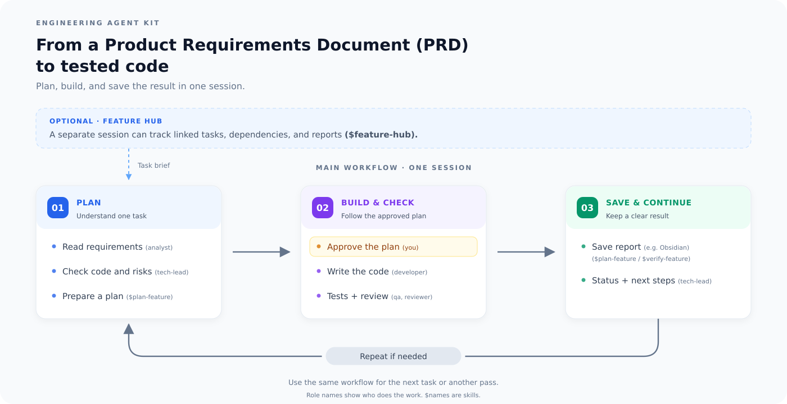

<div align="center">

# Engineering Agent Kit

### Clear tasks. Shared context. Tested code.

A local toolkit for building features with Codex — from a Product Requirements Document (PRD) to tested code.

[](https://github.com/OldHealer/engineering-agent-kit/actions/workflows/checks.yml)
[](LICENSE)


[Quick start](#quick-start) · [Your first feature](#your-first-feature) · [Skills](#skills) · [Permissions](#permissions-and-approvals)

</div>

---

Kit helps you plan a task, write code, and check the result in one session. For a feature with several linked tasks, you can add a feature hub to track progress and dependencies. **You set priorities and approve key decisions.**

| Plan clearly | Build step by step | Keep the context |
| :--- | :--- | :--- |
| Read the requirements and agree on a plan. | Write code, run tests, and review the result. | Save plans and reports as artifacts, for example in Obsidian. |

> [!NOTE]
> Kit runs locally on **Linux or WSL**. By default, one session works through the roles in order. A separate feature hub and parallel agents are optional.

## How it works



Role names in brackets show who does the work in the same session. Names with `$` are skills. A feature hub is an optional separate session for linked tasks.

> [!NOTE]
> The diagram shows a general artifact step. Current kit skills require full reports in Obsidian. Local project copies stay under `.engineering-kit/`.

## Quick start

**Choose your setup:**

| Setup | What you get | Start here |
| :--- | :--- | :--- |
| **Full kit** | Skills, MCP connections, project workspaces, and a permission profile | Follow steps 1–4 below |
| **Skills only** | The seven skills in your usual Codex session | [Install skills only](#skills-only) |

### 1. Get the project

You need Python 3.11+, Git, Node.js 22.12+, and Codex CLI. The scanner runtime has been tested with Codex 0.166.0 and 0.167.0. Check compatibility before using a newer version.

> [!IMPORTANT]
> Full setup also needs ready-to-use **ai-box dependencies**: the MCP SDK, zod, and built Bitbucket/Jira clients. The installer does not download them. Kit is not yet a complete one-command install.

Get the project:

```bash
git clone https://github.com/OldHealer/engineering-agent-kit.git
cd engineering-agent-kit
```

### 2. Set up your local files

From the kit folder:

```bash
mkdir -p .engineering-kit
cp config/local.example.json .engineering-kit/local.json
cp config/connections.example .engineering-kit/connections.env
```

> [!CAUTION]
> Fill in these local files **yourself**. Do not paste tokens into a chat. Git ignores this folder, and the agent must not read `connections.env`.

In `local.json`, set the full `ai_box` path. Add `network_hosts` and exact `mcp_hosts` lists for the services you use. Company hosts are not allowed by default. A service address in the secret file does not add network access automatically.

In `connections.env`, set the service addresses and tokens. Only the MCP process reads this file. It reads data without running shell commands. The agent must not read its contents. Git ignores everything in `.engineering-kit/`.

**Ready for the next step:** your dependency path and service settings are filled in locally.

### 3. Install kit

```bash
python3 scripts/launch.py install
```

You can also connect Context7 for public library documentation:

```bash
python3 scripts/launch.py install --with-context7
```

The installer creates `~/.local/bin/kit`, links to seven skills, and a separate Codex permission profile. Make sure `~/.local/bin` is in your `PATH`. If existing settings conflict, the installer keeps them and stops. It does not install dependencies or tokens for you.

> [!TIP]
> Keep the kit folder in the same location after installation. The links use this path.

### 4. Open your project

```bash
cd /absolute/path/to/project
kit
```

Send this first message:

> Connect this project to kit. Find its repositories and suggest a workspace mode.

Kit asks you to confirm the repositories and choose `current` or `worktree` mode. Registration alone does not create a task workspace or allow code changes.

### Resume your work

Use the project folder you started from:

```bash
kit resume
# Or choose a session by ID:
kit resume SESSION_UUID
```

`kit resume --last` opens the latest session for that folder. Plain `codex resume` uses your system Codex and does not run the kit wrapper.

To work on kit itself:

```bash
kit start --project /absolute/path/to/kit --kit-development
```

### Skills only

Want to try the workflow without MCP setup? From the cloned kit folder, run:

```bash
python3 scripts/kit.py install-skills
```

Then open your project in a normal Codex session. You can use the skills there. This option does not enable the kit permission profile or Git MCP.

## Your first feature

A Product Requirements Document (PRD) can describe one task or a feature with several tasks. Kit does not require a fixed format.

For one task, start with `$plan-feature` in a single session. For several linked tasks, you can use the optional feature hub workflow below.

### 1. Plan the feature

Open `kit` in your project folder and send:

```text
$feature-hub Read the PRD at <path or link>.
Track this feature in <feature folder in Obsidian>.
List the tasks and their dependencies. Suggest the first task.
Do not change code yet.
```

The feature hub reads the requirements, records open questions, and writes task briefs. Agree on the task list and key decisions before starting implementation.

### 2. Work on one task

Open another kit session from the same project:

```text
$plan-feature Read the task brief at <path> and prepare a plan.
```

In `worktree` mode, kit prepares a fresh copy from the agreed base **before reading the code**, even for a plan-only request. Creating a worktree does not allow implementation yet.

In `current` mode, kit uses the agreed project folder. It does not automatically include changes from other work.

> [!IMPORTANT]
> A prepared workspace or a finished plan is not approval to write code.

After you approve the plan:

```text
Implement the agreed plan. Run the checks and save a report.
Do not commit, push, or create a PR.
```

### 3. Check the result and return to the hub

For a separate QA session:

```text
$verify-feature Check the implementation against the task brief at <path>.
```

For code review:

```text
$review-pr Review the current uncommitted changes.
```

Then return to the main session:

```text
Read the reports for task <ID>, update its status, and suggest the next step.
```

The hub does not run on a schedule or receive results automatically. Ask it to read the latest reports.

## Skills

| Skill | Use it for |
| --- | --- |
| `$feature-hub` | Track several tasks from a PRD |
| `$plan-feature` | Plan and implement one task |
| `$verify-feature` | Check task or feature acceptance criteria |
| `$review-pr` | Review a PR, branch, or local changes |
| `$investigate-bug` | Find the cause of a bug |
| `$workspace-cleanup` | Check worktrees and remove approved folders |
| `$library-docs` | Find API documentation for the library version in your project |

Context7 is a separate, optional connection. Do not send source code, secrets, or private task details in public documentation requests.

## Local settings

| File or location | Purpose | Included in Git? |
| --- | --- | --- |
| `config/local.example.json` | Example paths and host lists | Yes, placeholders only |
| `config/connections.example` | Example connection variables | Yes, placeholders only |
| `.engineering-kit/local.json` | Settings for your installation | No |
| `.engineering-kit/connections.env` | Service addresses and tokens | No |
| `.engineering-kit/project.json`, `runs/`, `workspaces/` | Local project and task state | No |
| `~/.codex/kit-autonomy.json` | Personal permissions, artifact folders, network rules, and backend choice | Outside the repository |
| Obsidian | Full plans, task briefs, and reports | Outside the repository |

You can also set the dependency path with `--ai-box PATH` or `KIT_AI_BOX`. Keep personal paths, company domains, and tokens out of source files and public templates.

> [!WARNING]
> `.gitignore` does not remove already committed data or check file contents. Review the exact files before a commit or push. Never publish secret files, `.env` files, private keys, or personal task records.

### Where reports are saved

Choose a task folder in your Obsidian vault and pass its path to the hub or task session. Full plans and reports go there. Local project copies and links must stay under `.engineering-kit/`.

To allow writes to a folder:

```bash
kit policy --artifact-root /absolute/path/to/vault/tasks
```

This shows a preview. Review it, then repeat the same options with the returned `--apply TOKEN`. Replace `TOKEN` with the real confirmation token.

Each note starts with the session details and commands to resume it. Files and folders with `password`, `secret`, `credential`, or the Russian word part `парол` in their names stay blocked, even when the vault allows writes.

## Permissions and approvals

Recommended settings for local work:

```bash
kit policy --local-commit confirm --locked-dependencies auto
```

Review the preview, then repeat the same options with `--apply TOKEN`.

| Action | Behavior |
| --- | --- |
| Read code, make agreed changes, run checked build/lint/type/test commands | Run without extra approval in the allowed environment |
| Restore dependencies from a lock file | Run in `auto` mode after checking scripts and isolation |
| Commit | Approve the files and message in `confirm` mode |
| Add dependencies, manage services, or run database migrations | Ask for approval |
| Delete user data, push, or publish external comments | Ask for separate permission |
| Read real secrets or protected database data | Access is blocked |

Use `uv sync --locked`, `pnpm install --frozen-lockfile`, or the immutable/frozen option for your Yarn version. For npm, use `ci`. If there is no lock file, or a manifest needs to change, ask the user first.

A command name does not prove that it is safe. A test or install script may change a real database. Prefix rules cannot inspect all possible code. The sandbox, MCP limits, and the agent's checks work together. Actions outside the allowed area may still need technical approval.

### Network access

```bash
kit network --project /absolute/path/to/project
kit policy --network-profile python --network-profile node
kit policy --project /absolute/path/to/project --network-allow registry.example.com
```

`kit network` shows what the project needs. It does not grant access. Policy changes use preview/apply. Global rules apply to all projects. Project rules apply only to that project folder and its child folders. Deny rules take priority.

Shell commands use a network proxy. MCP services use their own exact host lists. The secret connection file does not grant more network access.

## Update a task branch from main

Ask Kit to update the task branch from `origin/main`. It uses Git MCP:

`fetch` → `merge_preview` → approved `merge` → fix conflicts and run checks → `commit_preview(mode="merge")` → approved `commit`.

Merge keeps the old HEAD until you approve the commit, even when a fast-forward is possible. The commit preview shows the full result and both parents. Push needs a separate request. To cancel, use `merge_abort_preview` and approve the exact changes that will be lost. Extra local changes block cancellation.

See [the Git MCP workflow](agents/integrations.md#обновление-ветки-задачи-из-origin) for tool arguments and limits. After updating Kit, open a new session with `kit start --project /absolute/path/to/project`; an existing chat does not gain new tools automatically.

## MVP limits

- Full mode targets Linux/WSL. Windows without WSL and macOS have not been tested.
- MCP needs prepared external ai-box dependencies.
- The native sandbox depends on the Codex version. Some protected folders may need the checked scanner owned by root. `kit scanner` shows an installation plan; it does not apply it automatically.
- The Codex 0.167.0 patch in `patches/` reduces repeated deny masks. Build the backend separately. Kit does not download or replace your system Codex automatically.
- Select a checked private backend with `kit policy --runtime-executable PATH` and preview/apply. Kit checks its components before launch. Use `--clear-runtime` to remove this choice. See [agents/permissions.md](agents/permissions.md) for details.
- Set up company connections and corporate CA trust locally. TLS checks stay enabled.
- Kit does not create PRs. Publishing and pushing need separate instructions.

## Checks and contributions

CI checks the publication files, Python/JavaScript syntax, and standalone configuration tests. It does not verify the native sandbox, company services, or the full development workflow.

In a prepared local environment, run the full checks with:

```bash
python3 scripts/check_publication.py
python3 -m unittest discover -s tests -v
node --test tests/test_mcp.mjs tests/test_git_mcp.mjs
```

The full suite needs Codex and ready-to-use ai-box dependencies. Some tests create a nested sandbox. MCP tests use synthetic connections and a local HTTP server. Never put working tokens or real data in test fixtures.

When reporting a bug, include your OS, tool versions, command, and a safe description of the expected and actual result. Do not attach `connections.env`, tokens, personal configs, database dumps, or full logs with sensitive data. Handle a possible leak privately first. Never post the secret itself in an issue.

Keep proposed changes small. Explain how you checked them and list any limits. See [AGENTS.md](AGENTS.md) for project rules. The publication check only covers known names and formats. Review the files manually before pushing.

## License and third-party code

The project's own code uses the [MIT License](LICENSE). You can use, change, and share it, including for commercial use. Keep the copyright notice and license text. The code comes as is, without warranties.

The `patches/codex-0.167.0-*.patch` files are based on the [rust-v0.167.0 OpenAI Codex tag](https://github.com/openai/codex/tree/rust-v0.167.0). They include parts of third-party code. The original [LICENSE](patches/CODEX-LICENSE) and [NOTICE](patches/CODEX-NOTICE) are stored separately. They do not apply to kit's own code.

Codex, bubblewrap, and V8 binaries, and ai-box dependencies, are not included in this repository. Do not assume that kit's license applies to them.

## Project layout

<details>
<summary>Show the project folders</summary>

```text
agents/       roles, workflows, and integration rules
skills/       seven user skills
scripts/      setup, launch, MCP, and permissions
bin/          the kit command and scanner adapters
permissions/  permission templates
config/       safe examples for local settings
patches/      version-specific native fixes
tests/        checks with isolated test data
```

</details>

Project rules: [AGENTS.md](AGENTS.md). Integration rules: [agents/integrations.md](agents/integrations.md).
